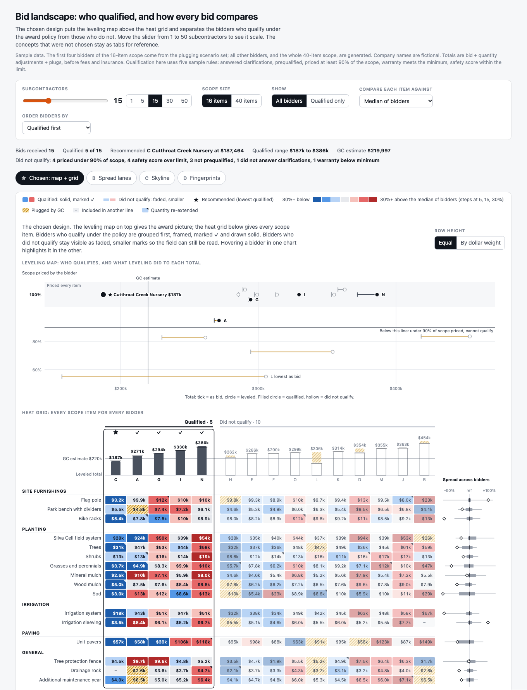
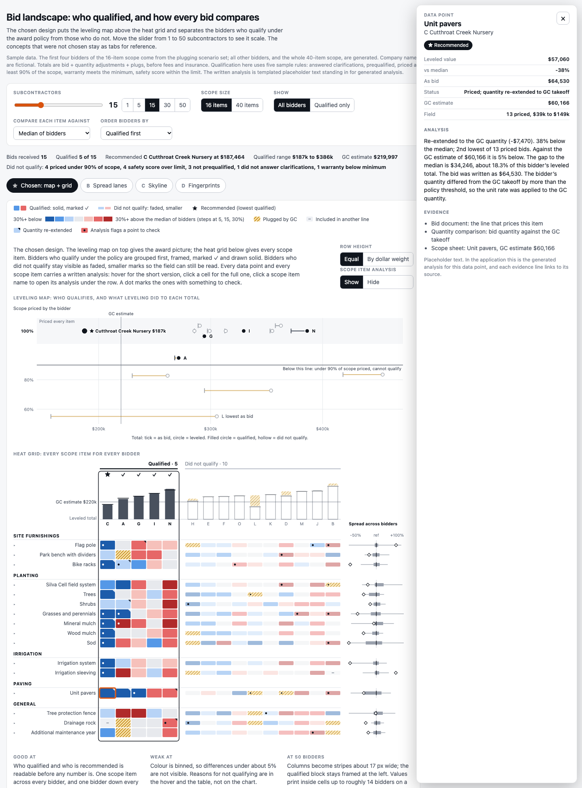

# Bid landscape visualization

Specification for the overview that sits with the Bid Level table. It shows every leveled bid for one
bid package at once, from 1 to 50 subcontractors, and makes two things readable before any number is:
**which bidders qualified under the award policy**, and **where bids differ on the same scope item**.

- Working prototype: `prototypes/bid-landscape/index.html` (open in a browser; no build step)
- Reference screenshots: `docs/img/bid-landscape-*.png`
- Status: design chosen from five prototyped concepts. Nothing here is built into the application yet.

## 1. What it is for

The Bid Level table reads well at 3 to 5 bidders. This view is its zoomed-out state. A user should be
able to answer these without hovering:

1. Who qualified, who did not, and who is recommended?
2. How did leveling change each total, and who is cheap only because scope is missing?
3. For a given scope item, who is high, who is low, and how contested is it?
4. For a given bidder, is the bid uniformly high or low, or uneven?
5. Which values are the bidder's own and which were plugged by the GC?
6. Where has the analysis found something to check?

It is made of two charts that share state, stacked vertically, plus a written analysis for every data
point and every scope item (section 10):

| Part | Answers | Size |
|---|---|---|
| **Leveling map** (top) | 1, 2 | fixed, about 340 px tall |
| **Heat grid** (bottom) | 1, 3, 4, 5, 6 | grows with the number of scope items |
| **Analysis** (hover, side panel, row band, row column) | why, for 3 to 6 | on demand |

## 2. Data contract

The view only draws. Leveling, plugging and qualification are computed elsewhere (plugging policy,
awarding policy) and passed in. Field names on the right are from the answer-key JSON in
`samples/tcjc_plugging/answer_key/<package>.json`, which already has this shape.

### Package

| Field | Notes | Answer-key source |
|---|---|---|
| `sections[]` | ordered: `name`, and the ordered scope items in it | not in the key today; needs adding to the scope sheet |
| `items[]` | `key`, `name`, `section`, `gcEstimate` | `gc_items[].key / desc / estimate` |
| `gcEstimateTotal` | sum of item estimates | derived |

### Bidder

| Field | Notes | Answer-key source |
|---|---|---|
| `id`, `name`, `code` | `code` is a short stable label (A, B ... AX) used when the name does not fit | `bidders[].company` |
| `asBid` | total as submitted | `bid_as_submitted` |
| `quantityAdjustments` | signed | `quantity_adjustments` |
| `plugs` | total plugged, including allowances if they are to be shown as plugs | `plug_total` (+ `allowance_total`) |
| `leveledTotal` | the number bidders are ranked on | `base_bid_value` in the prototype; see open question 1 |
| `scopePriced` | 0 to 1: share of scope, by GC estimate value, that the bidder priced itself (not plugged) | derived: 1 - sum(estimate of plugged items) / `gcEstimateTotal` |
| `qualified` | boolean, from the awarding policy | not in the key today |
| `reasons[]` | short strings, one per failed rule; empty when qualified | not in the key today |
| `rank` | 1..n among qualified bidders by `leveledTotal`; null otherwise | `ranking` |
| `cells[]` | one per scope item, see below | `lines[]` and `plugs[]` |

### Cell (bidder x scope item)

| Field | Values | Answer-key source |
|---|---|---|
| `status` | `priced`, `adjusted` (quantity re-extended), `plugged`, `included` (covered by another line) | `lines[].status` and `action`; `plugged` when the item appears in `plugs[]` |
| `value` | leveled value; plug value when plugged; null when included | `lines[].leveled_value`, `plugs[].value` |
| `asBid` | amount as written, when `adjusted` | `lines[].as_bid.amount` |
| `analysis` | see below | generated; not in the key |

### Analysis (one per cell, and one per scope item)

Every data point (bidder x scope item) and every scope item carries generated text. For 50 bidders and
40 items that is 2,000 cell analyses plus 40 scope item analyses.

| Field | Cell | Scope item | Notes |
|---|---|---|---|
| `headline` | not used | yes, at most 40 characters | shown in the column beside each row, e.g. "Contested · GC est. 25% under · 1 plug" |
| `short` | yes, at most about 140 characters | yes | shown in the hover tooltip |
| `full` | yes, a paragraph | yes | shown in the side panel (cell) or the band under the row (scope item) |
| `flag` | boolean | boolean | true when the analysis found something a person should check; drives the dot |
| `evidence[]` | yes | yes | references to source lines: bid document page and line, quantity comparison, plug calculation, scope sheet row |

`flag` must be selective to be useful. In the prototype's placeholder rules it is true for 4 to 13% of
cells (an isolated low or high price, a quantity re-extension of 15% or more, a plug worth 5% or more of
the bidder's total) and for scope items that are contested or that a fifth or more of the field left out.
The application should aim for the same order of magnitude: if most cells carry a dot, the dot means nothing.

### Derived in the view

- **Reference** per scope item (user option):
  - *Median of bidders* (default): median of `value` over cells with status `priced` or `adjusted`,
    from bidders who answered clarifications. Plugged values are excluded so plugs cannot pull the
    reference toward themselves.
  - *GC estimate*: `gcEstimate`.
  - *Lowest bid*: minimum over the same pool.
  - If an item has fewer than 3 priced values, the median falls back to the GC estimate and the page says so.
- **Deviation** = `value / reference - 1`.
- **Row spread**: min, lower quartile, median, upper quartile, max of the same pool.
- **Recommended** = qualified bidder with the lowest `leveledTotal`.

## 3. Qualification

Qualification comes from the awarding policy, after leveling. The view needs only the boolean and the
reasons. The prototype uses five sample rules so there is something to show: answered clarifications,
prequalified, priced at least 90% of scope by value, warranty meets the minimum, safety score within
the limit.

Qualified and not-qualified bidders are told apart by **position, shape and weight**, not by colour,
so the deviation colours keep their meaning for both groups.

| | Qualified | Did not qualify |
|---|---|---|
| Order (default) | first, sorted by leveled total | after a gap, sorted by leveled total |
| Group header | "Qualified · n", heavy rule above the columns, frame around the block | "Did not qualify · n", light rule |
| Column mark | check mark; star for the recommended bidder | none |
| Total bar | solid | outline only |
| Cell | full size, full strength, value in semibold | 42% fill opacity (plugged cells 72%, so the hatch stays legible); shrinks to about half height when there is no room for a number |
| Label | bold | regular, muted |
| Leveling map | filled circle, labelled | small hollow circle, line at 50% opacity, unlabelled |

Reasons for not qualifying appear in the hover, the bidder table and a one-line tally above the chart
("4 priced under 90% of scope, 3 not prequalified, ..."). A bidder can fail more than one rule.

A **Show** control switches between all bidders and qualified only. With qualified only, the
reference and the plugs are still computed from the full field; only the display is filtered.

If no bidder qualifies, the summary says so and nothing is starred.

## 4. Colour and marks

One diverging scale, binned into seven classes. Blue is below the reference, grey is near it, red is above.

| Class | Deviation | Light | Dark |
|---|---|---|---|
| 0 | -30% or lower | `#1c5cab` | `#6da7ec` |
| 1 | -30% to -15% | `#5598e7` | `#256abf` |
| 2 | -15% to -5% | `#b7d3f6` | `#173d6e` |
| 3 | within 5% | `#e7e9ed` | `#343a43` |
| 4 | +5% to +15% | `#f6c1bb` | `#5e2424` |
| 5 | +15% to +30% | `#e66767` | `#c03d3d` |
| 6 | +30% or higher | `#b02a2a` | `#f08a8a` |

Boundaries as implemented: `<= -0.30`, `<= -0.15`, `< -0.05`, `<= 0.05`, `< 0.15`, `< 0.30`, else class 6.
In both themes the class nearest the reference recedes toward the surface and the extremes stand out.
Text inside a cell is white or near-black by the cell's lightness, never the series colour.

Status marks, which do not depend on colour alone:

| Status | Mark |
|---|---|
| Plugged by GC | amber diagonal hatch (`#fbe7b3` ground, `#b97a00` lines; dark: `#4a3a12`, `#e0a020`); see "Plugged values" below |
| Included in another line | pale neutral cell with a short dash |
| Quantity re-extended | small triangle in the top-right corner of the cell |
| Recommended | star above the column and beside the point on the map |
| Qualified | check mark above the column |
| Selected bidder | 2 px accent frame around the column; accent ring on the map point |
| Analysis flag | a small dot in the cell (radius 2.4 px, 1.7 px in narrow or short cells), left of centre in wide cells and centred in narrow ones. It takes the cell's text colour so it reads on any class; on a plugged cell it is ink with an amber halo. In the scope item column the flag is an accent-coloured dot before the headline. |
| Data point open in the panel | 3 px accent outline around the cell |

### Plugged values

A plug is the GC's number, not the bidder's, so it is marked the same way everywhere it appears and is
never coloured on the deviation scale:

| Where | Mark |
|---|---|
| Heat grid cell | amber hatch instead of a deviation colour; value printed in ink with an amber halo when it fits |
| Total bar above each column | hatched top segment, separated from the priced part by a 2 px gap, so the plug share of each total is visible |
| Leveling map | the line from as-bid to leveled total is amber when the bidder carries plugs; its length is the plug amount plus adjustments |
| Scope item band (opened row) | an amber diamond instead of a tick or dot |
| Tooltip, panel, table | status "Plugged by GC"; plug total per bidder in the table |

Plugs are left out of the per-item reference (median, lowest) so they cannot pull the comparison toward
themselves, and the cell analysis says the value is the GC's and what share of the bidder's total it is.

Neutrals and accent (light / dark): surface `#ffffff` / `#161a21`, page `#f6f7f9` / `#0e1116`,
ink `#10151d` / `#eef0f3`, secondary ink `#49515e` / `#c2c7cf`, muted `#7d8592` / `#8b919c`,
gridline `#e2e5ea` / `#2a3039`, axis `#c3c8d1` / `#3d444f`, accent `#d9530e` / `#f0803f`.
Substitute the application's own tokens; keep the roles.

## 5. Leveling map

One mark per bidder.

- **X**: dollars, linear. Domain covers every as-bid and leveled total and the GC estimate, with a small margin.
- **Y**: scope priced by the bidder, 100% at the top. The lower bound is the lowest value in the field rounded down to 10%, and never above 80%.
- **Complete-bid lane**: bidders who priced 100% share a shaded lane at the top (64 px). Inside it they
  are stepped vertically so they do not overprint: try offsets 0, -13, +13, -25, +25 px and take the
  first that does not collide horizontally with a mark already at that offset.
- **Mark**: a vertical tick at the as-bid total, a line to the leveled total, and a circle at the
  leveled total. The line is amber when the bidder has plugs, neutral otherwise. Circle: filled, radius
  5.5 for qualified (7.5 for the recommended bidder); hollow, radius 4 for not qualified.
  Not-qualified marks are drawn first, at 50% opacity, so qualified marks sit on top.
- **Reference lines**: vertical line at the GC estimate, labelled; horizontal line at any policy
  threshold expressed in scope priced (90% in the prototype), labelled with its consequence
  ("Below this line: under 90% of scope priced, cannot qualify").
- **Labels**: recommended bidder gets star, name and total. Other qualified bidders get their code
  while there are 16 or fewer of them. The lowest as-bid total is called out when it is not the
  recommended bidder. Not-qualified bidders are labelled only when 8 or fewer bidders are shown.
  Labels have a surface-colour halo.
- **Caption** under the axis explains tick, circle, filled and hollow.

## 6. Heat grid

Rows are scope items grouped by section. Columns are bidders. This is the Bid Level table's own
structure, so the two can share ordering, selection and scroll position.

### Columns

- Default order **Qualified first**: qualified by leveled total, an 18 px gap, then the rest by leveled
  total. Other orders: leveled total, total as bid, similar pricing pattern (greedy nearest-neighbour
  chain on the clamped log-deviation vectors, starting from the lowest total). In those orders the
  groups interleave: there is no gap or frame, the header reads "5 of 15 qualified", and the check
  marks and solid drawing carry the distinction.
- Column width = available width / bidder count, clamped to 9..104 px. Below 9 px the grid scrolls
  horizontally inside its own container; the page never scrolls sideways.
- Gap between cells: 2 px at 14 px columns and wider, 1 px below.

### Header band, top to bottom

1. Group labels and rules (section 3).
2. Mark row: star or check per qualified column. Below 11 px columns the check becomes a small dot.
3. **Total bars** (92 px tall, bar at most 24 px wide): bar height is the leveled total; the lower
   part is scope the bidder priced and the upper hatched part is plugs, with a 2 px gap. A short
   horizontal tick marks the total as bid. A horizontal line marks the GC estimate.
4. Column label: bidder code from 22 px columns; code and truncated name from 70 px; below 22 px,
   position numbers every fifth column.

### Rows

- Section header rows (22 px) with the section name and a hairline.
- Item rows: 24 px for up to 20 items, 15 px above that.
- Option **Row height by dollar weight**: row height proportional to the item's median value, minimum
  6 px (4 px in the dense case), same total height. This shows where the money is; labels drop out
  for rows under 10 px.
- Item names are right-aligned in a 214 px label column (108 px on a phone) and truncated with an ellipsis.
  A disclosure triangle sits at the left edge. Clicking the name opens the scope item band (section 10).

### Cells

- Fill by deviation class, or the status mark from section 4.
- The value prints in the cell when the cell is at least 52 px wide and 16 px tall (roughly up to 14
  bidders on a desktop). This is the point where the view is effectively the table.
- Not-qualified cells: section 3.

### Spread column (right, 176 px; hidden on a phone)

One mini box plot per row on a shared log scale from -60% to +150% of the reference: line from min to
max, box for the middle half, tick at the median, and a diamond at the GC estimate. It tells the user
which items are contested without reading across 50 cells.

### Scope item analysis column (right of the spread column, 244 px)

The `headline` for each row, with an accent dot when the scope item is flagged. Shown when the grid is at
least 1,100 px wide and the user has not hidden it; hidden on a phone and while the data point panel is
open on a desktop, because the panel takes that width. Clicking a headline opens the row band.

## 7. Behaviour by bidder count

| Bidders | Heat grid | Leveling map |
|---|---|---|
| 1 | One column at maximum width with values and name. Colours compare against the GC estimate, and the page says so. | One mark. |
| 2 to 8 | Wide columns with code, name, total above each bar, values in cells. | Every bidder labelled. |
| 9 to 14 | Values still in cells; names drop out below 70 px columns. | Qualified labelled by code. |
| 15 to 30 | Cells become colour only; codes shown from 22 px columns; not-qualified cells shrink to half height. | Same. |
| 31 to 50 | Stripes about 17 px wide on a desktop; position numbers every fifth column. The qualified block stays framed at the left. | Complete-bid lane fills; labels only for qualified (up to 16) and the recommended bidder. |

Screenshots: [5](img/bid-landscape-05-bidders.png), [15](img/bid-landscape-15-bidders.png),
[50](img/bid-landscape-50-bidders.png), [15, ungrouped order, dark](img/bid-landscape-15-ungrouped-dark.png),
[analysis column and an open scope item](img/bid-landscape-analysis-row-open.png),
[data point panel](img/bid-landscape-analysis-panel.png), [panel on a phone](img/bid-landscape-analysis-phone.png).
The first four were taken before the analysis layer was added and do not show the dots or the column.

Scope size was tried at 16 and 40 items. Above about 60 items the grid should collapse sections to
their totals by default and expand on demand; that is not prototyped.

## 8. Controls

| Control | Options | Default |
|---|---|---|
| Show | all bidders, qualified only | all bidders |
| Order bidders by | qualified first, leveled total, total as bid, similar pricing pattern | qualified first |
| Compare each item against | median of bidders, GC estimate, lowest bid | median of bidders |
| Row height | equal, by dollar weight | equal |
| Scope item analysis | show, hide (the column beside the rows) | show |

A summary line above the charts states: bids received, qualified count, recommended bidder and total,
qualified range, GC estimate, and the tally of reasons for not qualifying.

## 9. Interaction

- **Hover a cell**: outline the cell; tooltip with item, bidder, qualified or not, leveled value,
  deviation, as-bid amount when adjusted, status, GC estimate, number of priced bids and their range,
  and the cell's `short` analysis under a divider.
- **Hover a scope item name**: tooltip with priced count, median, GC estimate and the item's `short` analysis.
- **Hover a column header or a map point**: tooltip with bidder, qualification (rank, or the reasons),
  leveled total, as bid, quantity adjustments, plugs, scope priced, deviation from the GC estimate.
- **Linked hover**: hovering a bidder in either chart highlights the same bidder in the other (column
  band in the grid, ring on the map).
- **Click a cell** to open its analysis in the side panel (section 10); click it again, press Esc or use
  the close button to close.
- **Click a column header or a map point** to select that bidder; click again to clear. Selection
  persists across both charts and should carry into the Bid Level table.
- **Click a scope item name or headline** to open its band under the row; click again to close. One band is open at a time.
- Map hit-testing is nearest-point within 40 px, so the pointer does not have to land on a 4 px circle.
- Tooltip text is inserted as text, never as HTML: bidder and item names come from uploaded documents.

Expected in the application but not in the prototype: evidence lines in the panel link to the source
(bid document page, plug calculation); zooming in hands over to the full table.

## 10. Written analysis

Text is always on demand. A 50 x 40 grid cannot show 2,000 paragraphs, so the chart shows only where
there is something to read (the flag dot), and the text opens at three depths.

| Depth | Data point (cell) | Scope item (row) |
|---|---|---|
| Glance | flag dot in the cell | `headline` in the column beside the row, accent dot when flagged |
| Hover | `short` in the tooltip, under the numbers | `short` in the tooltip |
| Open | **side panel**: item, bidder, qualification badge, key facts (leveled value, deviation, as bid, status, GC estimate, field range), the `full` analysis, a "Flagged: something to check" line when flagged, and the evidence list | **band under the row**: the `full` analysis on the left and a one-line strip of every bid for that item on the right (dots for qualified bidders, faded ticks for the rest, amber diamonds for plugs, triangle for the GC estimate) |

Side panel:

- Desktop (1,000 px and wider): a 360 px column fixed to the right. The page content shifts left to make
  room instead of being covered, and the grid re-flows to the narrower width.
- Phone: a bottom sheet, up to 64% of the screen height, scrolling on its own.
- The open cell keeps a 3 px accent outline in the grid. Only one cell is open at a time; clicking another cell replaces it.

Row band:

- About 160 px tall on desktop (276 px on a phone, where the strip goes under the text). The text area
  scrolls if the analysis is longer.
- The strip is the spread-lanes concept reduced to one item, so the precise per-item reading is still
  available when the user asks for it.

Writing guidance for the generator, from what the placeholder text needed to be useful:

- Lead with the fact that matters, then the comparison: "Re-extended to the GC quantity (-$7,470). 38% below the median; 2nd lowest of 13 priced bids."
- Use the same reference the chart is using (median, GC estimate or lowest bid), by name, so text and colour agree.
- For plugs, say the value is the GC's and how large it is relative to the bidder's total.
- For a bidder who did not qualify, say so and why, so the reader does not act on context-only numbers.
- End flagged analyses with a plain "To check:" sentence.
- Every number in the text must be traceable to an evidence line.

The analysis depends on the reference and on which bidders are in the field, so it must be regenerated
or re-templated when either changes (see open question 6).

## 11. Accessibility

- Qualification is carried by position, shape, fill and weight. Deviation is carried by colour, with
  values in the tooltip and in the table. Status is carried by hatch, dash and corner mark.
- A plain bidder table (rank, bidder, qualified, as bid, adjustments, plugs, leveled total, scope
  priced, reasons) is available under the charts and is the non-visual equivalent of the map.
  The Bid Level table is the equivalent of the grid.
- Blue and red arms were chosen as a warm/cool pair with a neutral midpoint; hatching keeps plugs
  distinct from both for colour-blind readers.
- Works at phone width: the grid scrolls inside its container, the spread and analysis columns are dropped, labels shorten, the panel becomes a bottom sheet.
- The panel's close button is a real button and Esc closes it. The cell analysis is also reachable from the
  Bid Level table, so the text is never available only through pointer hover.

## 12. Known limits of the prototype

- Deviation is binned, so differences under 5% do not show.
- In the dark theme a qualified cell near the reference is dark, close to a faded cell; the bold value
  and the frame carry the distinction there.
- Hover, click and linked highlight were written but not exercised in a real browser session; the
  layouts were checked from screenshots at 1, 5, 15, 30 and 50 bidders, 16 and 40 items, light and dark,
  desktop and phone width.
- Data: the first four bidders of the 16-item scope are from the plugging scenario set and tie to its
  answer key. All other bidders, the 40-item scope and every qualification attribute are generated.
- Plugs for generated bidders are a simple median of the others; the application uses the plugging policy.
- The analysis text is templated from the numbers, not generated. It shows the layout, lengths and
  flag rate the application should aim for, not the quality of real analysis. Evidence lines are labels, not links.
- Generating 2,000 cell analyses per package is a real cost and latency question for the application;
  the prototype does not measure it.

## 13. Open questions

1. **Which total?** The prototype ranks on bid + quantity adjustments + plugs. The Bid Level
   screenshot shows the same (base bid + plugs). The answer keys also carry Textura and SDI. Decide
   whether the overview ranks before or after those.
2. **Reference pool.** The median uses every bidder who answered clarifications, qualified or not.
   With few qualified bidders this keeps the median stable. The alternative is qualified bidders only.
3. **Policy thresholds on the map.** Only a scope-priced threshold can be drawn as a line. If the
   policy has a price rule (for example more than 20% below the GC estimate triggers review), it could
   be a second, vertical line.
4. **Sections.** The answer key has no section grouping for scope items; the scope sheet needs it.
5. **Bidder codes.** The prototype assigns A, B, ... in arrival order. The application may prefer the
   avatar letters already used in the Bid Level table.
6. **When analysis is regenerated.** Cell text refers to the median, rank and field range, which change
   when a bidder is added, a plug is revised or the reference is switched. Options: regenerate on every
   leveling run; generate against the default reference only and template the comparison sentence; or
   store the facts separately from the prose so numbers update without regenerating.
7. **Flag ownership.** Whether `flag` is decided by the model or by rules over the numbers (as in the
   prototype). Rules are predictable and cheap; the model can catch things rules miss, such as an
   exclusion buried in a bid's notes.

## 14. Running the prototype

Open `prototypes/bid-landscape/index.html`. For a fixed state when opened as a local file, add query
parameters: `?n=50&scope=large&ref=gc&sort=lev&show=qual&rows=weight&theme=dark&sel=3`.
`cell=2.12` opens the panel for bidder 2, scope item 12; `open=3` opens the band under scope item 3;
`notes=off` hides the scope item column.
The three concepts that were not chosen (spread lanes, skyline, fingerprints) remain as tabs for reference.
